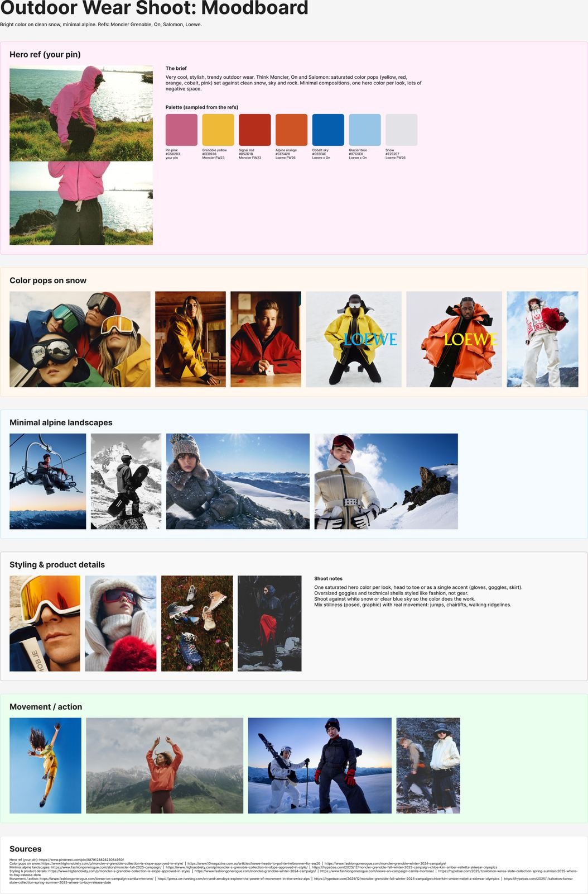
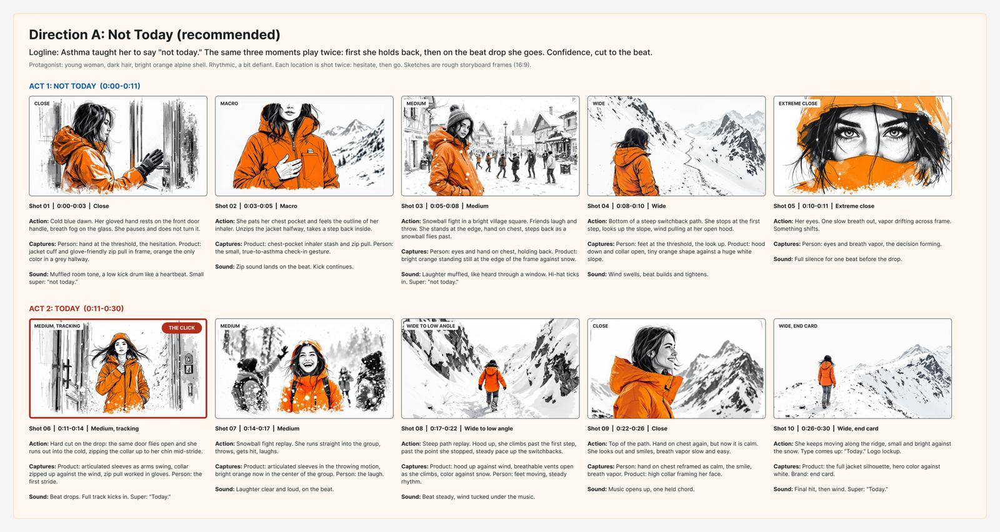
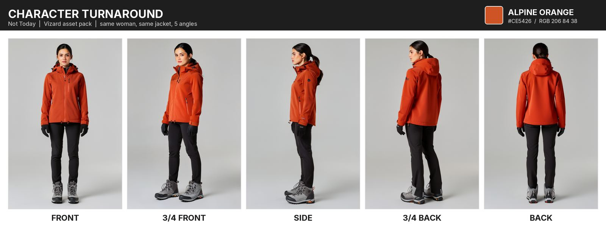
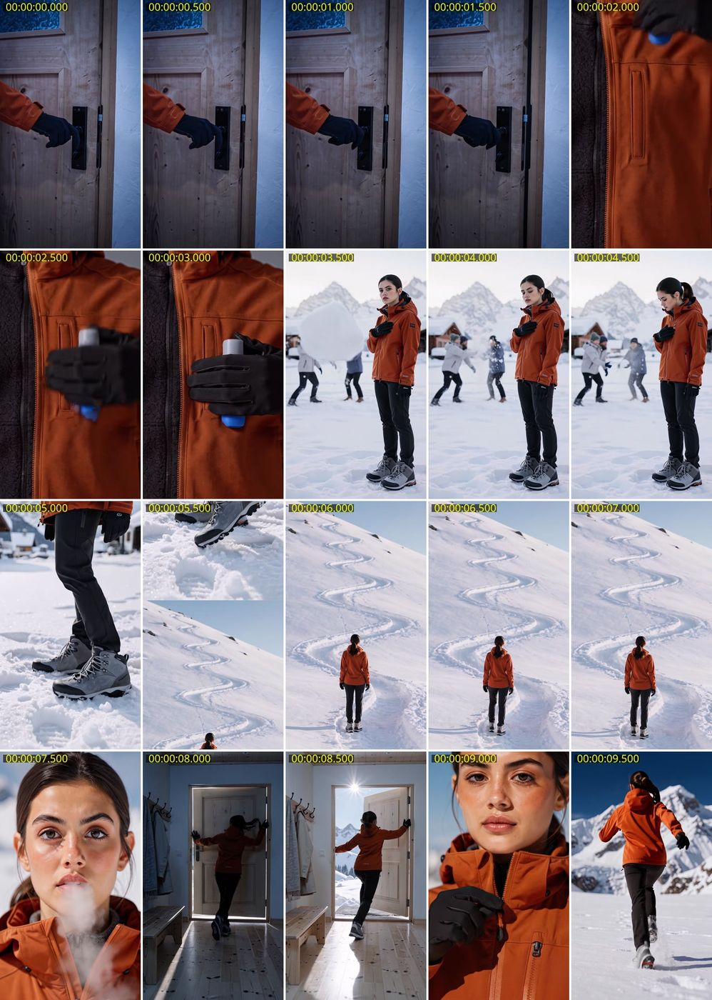
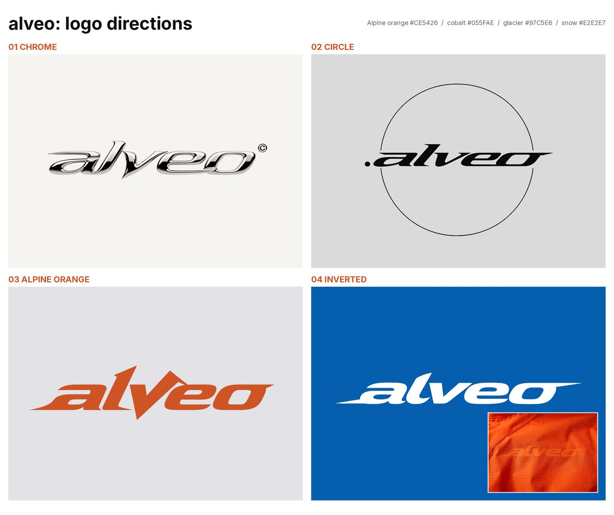

# Alveo: Not Today

A 30-second social film for an outdoor jacket made for people with asthma. Built in one afternoon on Oct 9, 2026.

**Pitch:** asthma taught her to say "not today." This jacket is what makes saying yes feel safe.

**Role:** Amy Wang, creative direction and AI workflow  
**Tools:** Figma / FigJam (Figma MCP), Black Forest Labs FLUX (stills + video), Vizard, Grok bots as creative partner  
**Board:** [FigJam](https://www.figma.com/board/CyC9LQc7xVnF5cSwfhKxLZ/Untitled)

Open [`index.html`](index.html) for the full case study (works on GitHub Pages, no build step).

---

## The insight

> For people with asthma, the fear of being out of breath is often what holds them back, more than the breath itself.

Three directions. I picked **Not Today**: hesitate, then go, with a hard cut on the beat.

## Process (one afternoon)

1. **Moodboard.** Moncler / On / Salomon alpine refs, Alpine orange `#CE5426`
2. **Insight + directions.** The Count, Not Today, Lungs of the Mountain
3. **FLUX storyboard.** 22 sketches; Not Today leads with 10 shots
4. **Vizard asset pack.** 33 stills + 6 reference sheets
5. **10s FLUX preview.** v1 self-critique, then v2 (door shove, zip to chin, blue inhaler)
6. **Brand.** Named **alveo**; logo 02 Circle to 2B Breath ring
7. **Workflow test.** Same shot plan in Vizard and direct BFL
8. **Story upgrade.** Turning point + about 20 shots; hand-on-chest as the thread
9. **Final cut in Vizard.** 33s with animated logo end card and music

## Thumbnail grid

| Moodboard | Storyboard | Assets | Preview | Brand |
|---|---|---|---|---|
|  |  |  |  |  |

## Final video

The 33-second final cut is at `assets/final/alveo_not_today_final.mp4` and shown on the case study page.

## Folder map

```
alveo-portfolio/
  index.html              # case study page (static, relative paths)
  README.md
  preview.png             # screenshot of the page
  process/
    timeline.md           # dated Oct 9, 2026 PDT timeline
    prompts.md            # exact prompts from the session
  assets/
    moodboard/            # board + contact sheet
    storyboard/           # A01-A10 + strip
    vizard/               # reference sheets + key stills
    preview/              # 10s FLUX v1/v2 mp4s + contact sheets
    keyframes/            # door, pocket, burst, zip
    brand/                # logo directions, breath ring, mockups, svg/
    final/                # put alveo_not_today_final.mp4 here
  scripts/                # generation + edit scripts (no secrets)
```

## What I learned

- Prefer **motivated transitions** (match cuts, snowball wipe, tilt) over generic crossfades.
- BFL's **safety filter** can block logo and mark edits; compositing the real mark with PIL kept spelling exact.
- A fair Vizard vs BFL test needs the **same shot plan, assets, and format**, then score consistency, transitions, the click, and cost.

## License / credit

Process archive for Amy Wang's portfolio. Reference photos on the FigJam moodboard remain copyright of their original brands and publications.
